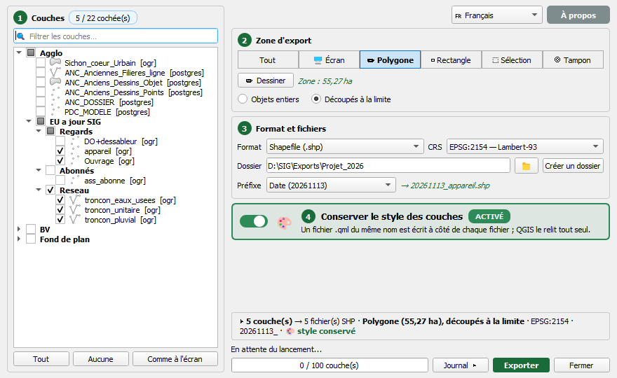
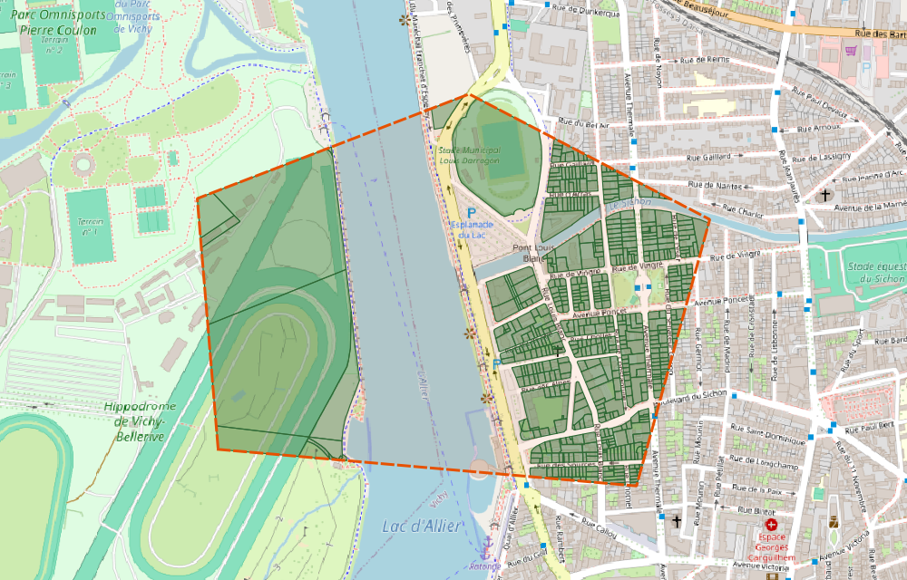
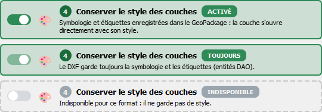
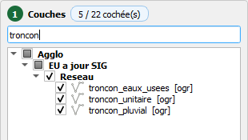
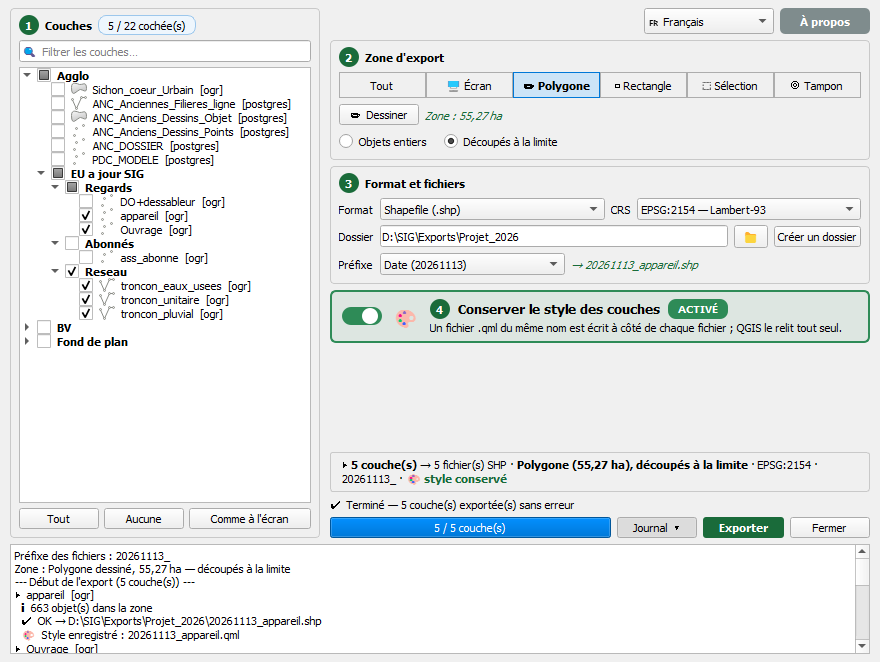

# Export_multilayers

> Plugin QGIS · v1.5.0 · QGIS 3.x et 4.x · FR / EN / ES / PT / DE

---

## Captures d'écran · Screenshots

<table>
<tr>
<td colspan="2" align="center"><br><sub><b>Fenêtre principale</b> — ① couches rangées comme le panneau Couches, ② zone d'export, ③ format et fichiers, ④ style · <i>Main window</i></sub></td>
</tr>
<tr>
<td colspan="2" align="center"><br><sub><b>Polygone dessiné</b> (pointillé orange) et parcelles exportées <b>découpées à la limite</b> · <i>Drawn area and features clipped at its limit</i></sub></td>
</tr>
<tr>
<td align="center" valign="top"><br><sub><b>Conserver le style</b> selon le format : GeoPackage, DXF, CSV · <i>Keep layer styles, per format</i></sub></td>
<td align="center" valign="top"><br><sub><b>Filtre</b> des couches · <i>Layer filter</i></sub></td>
</tr>
<tr>
<td colspan="2" align="center"><br><sub><b>Export terminé</b> : récapitulatif, préfixe date, style .qml, journal · <i>Export done, summary and log</i></sub></td>
</tr>
</table>

---

## Français

### Description

**Export_multilayers** est un plugin QGIS qui vous permet d'exporter en un clic l'ensemble (ou une sélection) de vos couches vecteur dans le format de votre choix, avec reprojection optionnelle et suivi de progression en temps réel dans un repertoire dédié.

Fini les allers-retours dans les menus : ouvrez le plugin, cochez vos couches, choisissez votre format et votre dossier de sortie — et laissez le plugin faire le reste.

### Fonctionnalités

- **12 formats d'export** (dont DXF en fichier unique) : GeoJSON, Shapefile, GeoPackage, CSV, Excel (XLSX), KML, GML, FlatGeobuf, MapInfo TAB, SQLite, DXF
- **Reprojection à la volée** : Lambert-93 (EPSG:2154), WGS 84 (EPSG:4326), Web Mercator (EPSG:3857), ou conservation du CRS d'origine
- **Sélection flexible** : cochez / décochez les couches individuellement ou via les boutons *Tout sélectionner* / *Tout désélectionner* / *Comme à l'écran* (couches affichées sur la carte)
- **Barre de progression** et journal en temps réel pour suivre chaque export
- **Export DXF intelligent** : les polygones sont automatiquement convertis en contours (lignes) pour assurer la compatibilité DXF
- **Interface en 5 langues** : français, anglais, espagnol, portugais, allemand, sans redémarrer le plugin
- **Conserver le style des couches** (option) : en GeoPackage, le style (symbologie + étiquettes) est enregistré dans le fichier et appliqué à l'ouverture ; en Shapefile, GeoJSON, FlatGeobuf, TAB, GML et SQLite, un fichier `.qml` du même nom est écrit à côté et relu automatiquement par QGIS
- **Préfixe des fichiers** : aucun, date (`20261113_`), date et heure (`20261113_1154_`), texte libre ou date + texte — aperçu du nom en direct
- **Zone d'export** : toute la couche, emprise de l'écran, polygone ou rectangle dessiné sur la carte, entités sélectionnées (une commune, un bassin…) ou tampon de X m autour de la sélection — objets **entiers** ou **découpés** à la limite de la zone
- Un fichier par couche, nommé d'après la couche — sauf en **GeoPackage** et **DXF fichier unique**, où toutes les couches vont dans un seul fichier ; en GeoPackage, le nom du fichier est demandé au lancement

### Installation

1. Téléchargez ou clonez ce dépôt :

   ```bash
   git clone https://github.com/Cartoyoyo/Export_multilayers.git
   ```

2. Copiez le dossier `Export_multilayers` dans le répertoire des plugins QGIS :

   | Système | Chemin |
   |---------|--------|
   | Windows | `C:\Users\<utilisateur>\AppData\Roaming\QGIS\QGIS3\profiles\default\python\plugins\` |
   | macOS   | `~/Library/Application Support/QGIS/QGIS3/profiles/default/python/plugins/` |
   | Linux   | `~/.local/share/QGIS/QGIS3/profiles/default/python/plugins/` |

3. Ouvrez QGIS, allez dans **Extensions → Installer/Gérer les extensions**, cochez **Export Couches Vecteur** et cliquez sur **OK**.

4. Une icône apparaît dans la barre d'outils et un menu **Export Couches Vecteur** est ajouté.

### Utilisation

Imaginez que vous avez un projet QGIS bien rempli — des dizaines de couches, des données en tout genre, et votre chef vous demande *"tu peux m'envoyer tout ça en Shapefile pour ce soir ?"*. Pas de panique !

1. **Lancez le plugin** via la barre d'outils ou le menu **Extensions → Export Couches Vecteur**.
2. **① Couches** (colonne de gauche) : les couches vecteur apparaissent rangées comme dans le panneau Couches, cochées par défaut. Cochez un groupe pour toutes ses couches, filtrez par nom, ou cliquez *Comme à l'écran* pour ne garder que les couches affichées.
3. **② Zone d'export** : *Tout*, *Écran*, *Polygone* ou *Rectangle* dessiné sur la carte, *Sélection* (une commune, un bassin…) ou *Tampon* autour de la sélection — puis objets **entiers** ou **découpés** à la limite.
4. **③ Format et fichiers** : format (GeoJSON pour votre équipe web, Shapefile pour votre client old-school, DXF pour votre collègue sous AutoCAD…), CRS, dossier de sortie et préfixe éventuel (date `20261113_`, date et heure `20261113_1154_`, texte).
5. **④ Conserver le style** : un interrupteur pour que les fichiers s'ouvrent avec leur symbologie et leurs étiquettes.
6. Vérifiez la ligne de **récapitulatif**, cliquez sur **Exporter** et regardez la barre de progression avancer.
7. Le **journal** (bouton *Journal*) détaille chaque couche ; il s'ouvre tout seul en cas d'erreur.

> **Astuce** : les formats CSV et Excel n'exportent que les attributs, pas la géométrie. Le plugin vous en avertit dans le journal.

### Formats supportés

| Format | Extension | Géométrie |
|--------|-----------|-----------|
| GeoJSON | `.geojson` | ✔ |
| Shapefile | `.shp` | ✔ |
| GeoPackage | `.gpkg` | ✔ |
| KML | `.kml` | ✔ |
| GML | `.gml` | ✔ |
| FlatGeobuf | `.fgb` | ✔ |
| MapInfo TAB | `.tab` | ✔ |
| SQLite | `.sqlite` | ✔ |
| DXF | `.dxf` | ✔ (géométrie seule) |
| CSV | `.csv` | ✘ (attributs seuls) |
| Excel | `.xlsx` | ✘ (attributs seuls) |

---

## English

### Description

**Export_multilayers** is a QGIS plugin that lets you export all (or a selection) of your vector layers in your chosen format, with optional reprojection and real-time progress tracking — all from a single, clean dialog, in a repertory.

No more digging through menus: open the plugin, check your layers, pick a format and output folder, and let the plugin handle the rest.

### Features

- **12 export formats** (including single-file DXF): GeoJSON, Shapefile, GeoPackage, CSV, Excel (XLSX), KML, GML, FlatGeobuf, MapInfo TAB, SQLite, DXF
- **On-the-fly reprojection**: Lambert-93 (EPSG:2154), WGS 84 (EPSG:4326), Web Mercator (EPSG:3857), or keep original CRS
- **Flexible selection**: check / uncheck layers individually or use the *Select all* / *Deselect all* / *As on screen* (layers shown on the map) buttons
- **Progress bar** and real-time log to track every export
- **Smart DXF export**: polygons are automatically converted to outlines (lines) for DXF compatibility
- **5-language interface**: French, English, Spanish, Portuguese, German, no restart needed
- **Keep layer styles** (option): in GeoPackage, the style (symbology + labels) is stored in the file and applied when opened; in Shapefile, GeoJSON, FlatGeobuf, TAB, GML and SQLite, a `.qml` file with the same name is written alongside and loaded automatically by QGIS
- **File name prefix**: none, date (`20261113_`), date and time (`20261113_1154_`), free text or date + text — live name preview
- **Export area**: whole layer, screen extent, polygon or rectangle drawn on the map, selected features (a municipality, a catchment…) or an X m buffer around the selection — features kept **whole** or **clipped** at the area limit
- One file per layer, named after the layer — except **GeoPackage** and **single-file DXF**, where all layers go into one file; for GeoPackage, the file name is asked when the export starts

### Installation

1. Download or clone this repository:

   ```bash
   git clone https://github.com/Cartoyoyo/Export_multilayers.git
   ```

2. Copy the `Export_multilayers` folder to your QGIS plugins directory:

   | OS | Path |
   |----|------|
   | Windows | `C:\Users\<username>\AppData\Roaming\QGIS\QGIS3\profiles\default\python\plugins\` |
   | macOS   | `~/Library/Application Support/QGIS/QGIS3/profiles/default/python/plugins/` |
   | Linux   | `~/.local/share/QGIS/QGIS3/profiles/default/python/plugins/` |

3. Open QGIS, go to **Plugins → Manage and Install Plugins**, check **Export Couches Vecteur** and click **OK**.

4. An icon appears in the toolbar and a **Export Couches Vecteur** menu is added.

### Usage

Picture this: your QGIS project is packed with dozens of layers and your manager just asked *"can you send me all of that as Shapefiles by tonight?"*. No stress!

1. **Launch the plugin** from the toolbar or the **Plugins → Export Couches Vecteur** menu.
2. **(1) Layers** (left column): vector layers are grouped as in the Layers panel and pre-checked. Check a group for all its layers, filter by name, or click *As on screen* to keep only the layers shown on the map.
3. **(2) Export area**: *All*, *Screen*, *Polygon* or *Rectangle* drawn on the map, *Selection* (a municipality, a catchment…) or *Buffer* around the selection — then features kept **whole** or **clipped** at the limit.
4. **(3) Format and files**: format (GeoJSON for your web team, Shapefile for your old-school client, DXF for your AutoCAD colleague…), CRS, output folder and optional prefix (date `20261113_`, date and time `20261113_1154_`, text).
5. **(4) Keep layer styles**: one switch so the files open with their symbology and labels.
6. Check the **summary** line, click **Export** and watch the progress bar fill up.
7. The **log** (*Log* button) details each layer; it opens by itself if something goes wrong.

> **Tip**: CSV and Excel formats export attributes only — no geometry. The plugin will warn you in the log.

### Supported Formats

| Format | Extension | Geometry |
|--------|-----------|----------|
| GeoJSON | `.geojson` | ✔ |
| Shapefile | `.shp` | ✔ |
| GeoPackage | `.gpkg` | ✔ |
| KML | `.kml` | ✔ |
| GML | `.gml` | ✔ |
| FlatGeobuf | `.fgb` | ✔ |
| MapInfo TAB | `.tab` | ✔ |
| SQLite | `.sqlite` | ✔ |
| DXF | `.dxf` | ✔ (geometry only) |
| CSV | `.csv` | ✘ (attributes only) |
| Excel | `.xlsx` | ✘ (attributes only) |

---

## Changelog

See [CHANGELOG.md](CHANGELOG.md) for the full history.

| Version | Date | Notes |
|---------|------|-------|
| **1.5.0** | 2026-11-13 | Zone d'export (écran, polygone ou rectangle dessiné, sélection, tampon ; objets entiers ou découpés) — conserver le style des couches — préfixe date / heure / texte — nouvelle fenêtre en 2 colonnes |
| **1.4.0** | 2026-10-17 | Nom du GeoPackage demandé à l'export — DXF fichier unique — export à l'emprise — interface 5 langues — CSV français — nouvel « À propos » — compatibilité QGIS 4 |
| **1.3.0** | 2026-02-28 | Dialog "À propos" (logo, licence, GitHub) — plugin dans le menu Vecteur — fichier `LICENSE` — commentaires en anglais |
| **1.2.0** | 2025 | Correction de l'export DXF via `QgsVectorFileWriter` — conversion automatique des polygones en contours |
| **1.1.0** | 2025 | Ajout des formats DXF, KML, GML, FlatGeobuf, TAB, SQLite, Excel — interface bilingue FR/EN |
| **1.0.0** | 2025 | Version initiale |

---

## Auteur · Author

Développé par / Developed by **Yoan Laloux**

Technicien SIG · GIS Technician

- LinkedIn : [linkedin.com/in/ylaloux](https://www.linkedin.com/in/ylaloux/)

Concept et idée originale par Yoan Laloux — développé avec l'assistance d'outils d'IA générative.
Concept and original idea by Yoan Laloux — developed with the assistance of generative AI tools.

---

## Licence · License

Ce projet est distribué sous licence **GNU General Public License v2.0**, conformément aux exigences de l'écosystème de plugins QGIS.

This project is distributed under the **GNU General Public License v2.0**, in line with the QGIS plugin ecosystem requirements.
